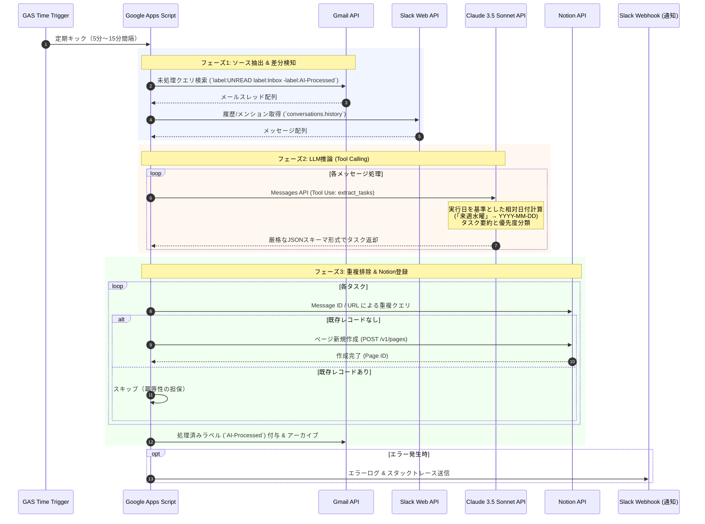

# 【完全無料・完全自動】Claude 3.5 Sonnet × Google Apps Scriptで構築する「未読Gmail & SlackからNotionへの自律型タスク抽出パイプライン」（全コード・例外処理付き）

こんにちは。「仕事効率化・生成AIツール特化メディア」エンジニア・高度自動化担当のライターです。

エンジニアや社内SE、テック系ビジネスパーソンにとって、日々の最大の生産性キラーは**「コミュニケーションツール間のコンテキストスイッチ」**と**「散らばったタスクの手動転記」**ではないでしょうか。

「Gmailでクライアントから仕様変更の連絡が届き、Slackの別チャンネルで同僚からレビュー依頼が飛び、気づけばNotionのToDoリストへの登録が漏れて締め切り直前に青ざめる……」

このような課題に対し、ZapierやMakeなどのiPaaSを導入する企業も多いですが、無料枠のステップ数制限（月100回程度）や、非構造化テキストから「本当に自分がやるべきタスク・期限・優先度」を精度高く抜き出すLLM処理の従量コスト・有料プラン制限がボトルネックになりがちです。

そこで本記事では、**サーバー構築不要・維持コスト実質ゼロ（Googleの無料枠内で稼働）**の**Google Apps Script (GAS)**をオーケストレーターとし、現行LLMで最高峰の日本語推論力・構造化データ抽出精度を誇る**Anthropicの「Claude 3.5 Sonnet」**、そして情報ハブである**Notion API**を直結した**「自律型タスク抽出パイプライン」**を構築します。

コピペでそのまま本番稼働できる完全なスクリプト（指数バックオフ、GASの6分制限回避、重複登録防止、Slackエラー通知完備）と、NotionのDBスキーマ定義をすべてオープンに公開します。

---

## 1. 課題とシステムアーキテクチャ概要

### 1.1 なぜ「GAS × Claude 3.5 Sonnet」なのか？

| 比較項目 | 一般的なiPaaS（Zapier/Make） | 本アーキテクチャ（GAS + Claude 3.5 Sonnet） |
| :--- | :--- | :--- |
| **月額固定費** | 月$20〜$50（無料枠は即枯渇） | **完全無料（Google無料枠内）** |
| **LLM実行コスト** | 各種アドオン契約が必要な場合あり | **Anthropic APIの従量課金のみ（月数百円程度）** |
| **テキスト解析力** | 単純な正規表現や低機能モデル | **Claude 3.5 Sonnetによる高度な意図・期限推論** |
| **カスタマイズ性** | ノード数・フロー制限あり | **JavaScript/TypeScriptで自由なロジック記述が可能** |
| **運用保守性** | GUI変更によるサイレント障害 | **コード管理可能（clasp等でGit管理対応）** |

GASはGoogle Workspaceアカウント（無料の個人Gmailでも可）さえあれば、cronサーバーを用意することなく5分〜15分間隔で定期自律実行が可能です。

### 1.2 アーキテクチャ構成

Gmailの未読メールおよびSlackのメンション・特定チャンネルから新着メッセージを検出し、Claude 3.5 Sonnetの**Tool Use（Structured Outputs）**によって、「タスクの有無」「タイトル」「期日（ISO8601形式）」「優先度」「背景要約」を厳格なJSONとして抽出。Notion APIを通じてタスクDBへUPSERTします。

---

## 2. システム全体像とシーケンス図

本システムは、GASの定期トリガー（Time-driven Trigger）によって数分おきに自律起動します。



---

## 3. 前提条件とAPIキーの取得手順

実装に入る前に、必要な各種APIキーとトークンを準備します。

### 3.1 Anthropic APIキーの取得
1. [Anthropic Console](https://console.anthropic.com/) にアクセスし、アカウントを作成・ログインします。
2. 左メニューの **「API Keys」** から **「Create Key」** をクリックし、生成されたキー（`sk-ant-api03-...`）を安全に退避します。
3. **「Billing」** から初期クレジット（$5〜$10程度）を入金します。

### 3.2 Notion Integration Token & データベースIDの取得
1. [Notion Developers: My Integrations](https://www.notion.so/profile/integrations) にアクセスします。
2. **「+ New integration」** を作成：
   - Type: **Internal**
   - Associated workspace: タスクを管理したいワークスペースを選択
   - Capabilities: **Read content**, **Update content**, **Insert content** にチェック
3. 発行された **Internal Integration Secret**（`ntn_...` または `secret_...`）を控えます。
4. タスク管理用のNotionデータベースを作成します（プロパティ構成は第5章参照）。
5. データベース右上の **「…」➔「Connections（接続）」➔ 先ほど作成したインテグレーションを追加** します。
6. ブラウザのURLバーから **Database ID** を抽出します：
   ```text
   https://www.notion.so/{workspace_name}/{DATABASE_ID}?v={view_id}
   ```
   ※ `{DATABASE_ID}` 部分（32文字の英数字ハイフンなし）をコピーします。

### 3.3 Slack Bot Token / Incoming Webhookの取得
1. [Slack API: Your Apps](https://api.slack.com/apps) から **「Create New App」** ➔ **「From scratch」** を選択。
2. **「Incoming Webhooks」** を有効化し、タスク通知・エラー通知を行いたいチャンネル（例: `#alert-ai-ops`）へのWebhook URLを生成。
3. （Slackメッセージから抽出する場合）**「OAuth & Permissions」** ➔ **Bot Token Scopes** に `channels:history`, `groups:history`, `im:history`, `mpim:history` を追加し、ワークスペースにインストール（`xoxb-...` を取得）。

### 3.4 GAS スクリプトプロパティの設定
コード内にAPIキーをハードコードするのは厳禁です。Google Apps Scriptの「スクリプトプロパティ」に保存します。

1. Google Driveで **新規 ➔ その他 ➔ Google Apps Script** を作成。
2. 左メニューの **歯車アイコン（プロジェクトの設定）** ➔ **「スクリプト プロパティ」** に以下を登録：

| プロパティ名 | 設定値の例 |
| :--- | :--- |
| `ANTHROPIC_API_KEY` | `sk-ant-api03-...` |
| `NOTION_API_KEY` | `ntn_...` |
| `NOTION_DATABASE_ID` | `c2a1b3...`（32桁） |
| `SLACK_WEBHOOK_URL` | `https://hooks.slack.com/services/...` |
| `SLACK_BOT_TOKEN` | `xoxb-...`（Slackメッセージ解析を行う場合） |
| `GMAIL_SEARCH_QUERY` | `is:unread -label:AI-Processed` |

---

## 4. 【完全掲載】Google Apps Scriptの実装コード

GASのプロジェクト内に、以下のコードを貼り付けます。
単一ファイル（`Code.gs`）にそのまま配置して動作するプロダクション構成です。

> [!IMPORTANT]
> **GASの「6分制限」対策と「指数バックオフ（Exponential Backoff）」**:
> GASはトリガー実行のタイムアウトが最大6分（360秒）に制限されています。本コードでは開始からの経過時間をミリ秒単位で監視し、270秒（4分30秒）を超えた時点で処理を安全に中断・次回トリガーへ委託するセーフガードを組み込んでいます。また、AnthropicおよびNotion APIのレート制限（HTTP 429）を自動リトライする指数バックオフ処理を内蔵しています。

```javascript
/**
 * ==========================================================================
 * 自律型タスク抽出パイプライン: Gmail / Slack -> Claude 3.5 Sonnet -> Notion
 * ==========================================================================
 */

// 実行時間セーフティリミット（ミリ秒）: 4分30秒
const EXECUTION_TIMEOUT_MS = 270 * 1000;

/**
 * 環境変数の取得ヘルパー
 */
function getEnv(key) {
  const val = PropertiesService.getScriptProperties().getProperty(key);
  if (!val) {
    throw new Error(`[Config Error] スクリプトプロパティ "${key}" が設定されていません。`);
  }
  return val;
}

/**
 * メインエントリーポイント（時間主導型トリガーから起動）
 */
function main() {
  const startTime = Date.now();
  console.log(`[Start] タスク抽出パイプラインを開始します: ${new Date().toISOString()}`);

  try {
    // 1. Gmailからの未読タスク抽出
    processGmailPipeline(startTime);

    // 2. Slackからのタスク抽出（必要に応じて有効化）
    // processSlackPipeline(startTime);

    console.log(`[Finish] パイプラインが正常に終了しました。経過時間: ${(Date.now() - startTime) / 1000}s`);
  } catch (error) {
    console.error(`[Critical Error] メインパイプラインで例外が発生しました: ${error.stack}`);
    sendSlackAlert(`:rotating_light: *[GASパイプライン異常終了]*\n\`\`\`${error.stack}\`\`\``);
  }
}

/**
 * Gmail処理パイプライン
 */
function processGmailPipeline(startTime) {
  const query = PropertiesService.getScriptProperties().getProperty('GMAIL_SEARCH_QUERY') || 'is:unread -label:AI-Processed';
  const threads = GmailApp.search(query, 0, 15); // 1回あたり最大15スレッド

  if (threads.length === 0) {
    console.log('[Gmail] 処理対象の未読メールはありません。');
    return;
  }

  // 処理済みラベルの取得または作成
  let processedLabel = GmailApp.getUserLabelByName('AI-Processed');
  if (!processedLabel) {
    processedLabel = GmailApp.createLabel('AI-Processed');
  }

  for (const thread of threads) {
    // タイムアウトチェック
    if (Date.now() - startTime > EXECUTION_TIMEOUT_MS) {
      console.warn('[Safety] GAS実行時間上限に近づいたため、安全にループを中断します。');
      break;
    }

    const messages = thread.getMessages();
    const lastMessage = messages[messages.length - 1]; // 最新メッセージを主対象に

    const messageId = lastMessage.getId();
    const subject = thread.getFirstMessageSubject();
    const sender = lastMessage.getFrom();
    const date = lastMessage.getDate().toISOString();
    const body = lastMessage.getPlainBody().substring(0, 4000); // 最大4,000文字で安全に切り詰め
    const threadUrl = `https://mail.google.com/mail/u/0/#inbox/${thread.getId()}`;

    console.log(`[Processing] メール解析中: "${subject}" (From: ${sender})`);

    // Claude 3.5 Sonnet によるタスク解析
    const extractionResult = extractTasksWithClaude({
      source: 'Gmail',
      title: subject,
      sender: sender,
      content: body,
      receivedAt: date
    });

    if (extractionResult && extractionResult.has_task && extractionResult.tasks.length > 0) {
      for (const task of extractionResult.tasks) {
        // Notionへの登録（重複チェック付き）
        createNotionTask({
          title: task.task_name,
          dueDate: task.due_date, // YYYY-MM-DD または null
          priority: task.priority, // High, Medium, Low
          sourceType: 'Gmail',
          sender: sender,
          summary: task.summary,
          externalId: `${messageId}_${task.task_name}`,
          sourceUrl: threadUrl
        });
      }
    } else {
      console.log(`[Skip] タスクは検出されませんでした: "${subject}"`);
    }

    // 処理済みマーク（ラベル付与＆既読化）
    thread.addLabel(processedLabel);
    thread.markRead();
  }
}

/**
 * Claude 3.5 Sonnet Messages API (Tool Use / Structured Outputs)
 */
function extractTasksWithClaude(data) {
  const apiKey = getEnv('ANTHROPIC_API_KEY');
  const todayStr = Utilities.formatDate(new Date(), 'Asia/Tokyo', 'yyyy-MM-dd (E)');

  const systemPrompt = `
あなたは極めて優秀なエグゼクティブ・アシスタント兼タスク抽出AIです。
入力されたビジネスコミュニケーション（メールやSlack）から、受取人が実行・対応・返信・確認すべき「明確なタスク」を抽出してください。

【厳格な抽出ルール】
1. メルマガ、システム自動通知、単なる広告、タスクを伴わない連絡・お礼のみの場合は has_task: false としてください。
2. 相対的な日付表現（「明日」「来週火曜」「今月末」「金曜中」など）は、基準日（今日: ${todayStr}）から厳密に計算し、"YYYY-MM-DD" 形式に変換してください。明記がない場合は null としてください。
3. 優先度は重要度と緊急度から [High, Medium, Low] の3段階で判定してください。
4. 複数の独立したタスクが含まれる場合は、配列として複数抽出してください。
`;

  const userContent = `
【入力データ情報】
- 送信元/チャネル: ${data.source}
- 差出人: ${data.sender}
- 表題/タイトル: ${data.title}
- 受信日時: ${data.receivedAt}

【本文】
${data.content}
`;

  // Tool Use を用いた構造化データ抽出スキーマ
  const tools = [
    {
      name: "submit_extracted_tasks",
      description: "抽出されたタスク情報の配列を出力するツール",
      input_schema: {
        type: "object",
        properties: {
          has_task: {
            type: "boolean",
            description: "実行すべきタスクが存在するかどうか"
          },
          tasks: {
            type: "array",
            items: {
              type: "object",
              properties: {
                task_name: {
                  type: "string",
                  description: "簡潔で実行可能なタスク名（例: 『〇〇社へ見積書の修正版を再送する』）"
                },
                due_date: {
                  type: ["string", "null"],
                  description: "期日 (YYYY-MM-DD形式)。不明時はnull"
                },
                priority: {
                  type: "string",
                  enum: ["High", "Medium", "Low"],
                  description: "優先度"
                },
                summary: {
                  type: "string",
                  description: "タスクの背景・文脈・補足要約（200文字以内）"
                }
              },
              required: ["task_name", "due_date", "priority", "summary"]
            }
          }
        },
        required: ["has_task", "tasks"]
      }
    }
  ];

  const payload = {
    model: "claude-3-5-sonnet-20241022",
    max_tokens: 1500,
    temperature: 0,
    system: systemPrompt,
    messages: [
      { role: "user", content: userContent }
    ],
    tools: tools,
    tool_choice: { type: "tool", name: "submit_extracted_tasks" }
  };

  const response = fetchWithBackoff("https://api.anthropic.com/v1/messages", {
    method: "post",
    contentType: "application/json",
    headers: {
      "x-api-key": apiKey,
      "anthropic-version": "2023-06-01"
    },
    payload: JSON.stringify(payload)
  });

  const resJson = JSON.parse(response.getContentText());
  
  // Tool Call結果の抽出
  if (resJson.content && resJson.content.length > 0) {
    const toolUseBlock = resJson.content.find(block => block.type === "tool_use");
    if (toolUseBlock && toolUseBlock.input) {
      return toolUseBlock.input;
    }
  }

  return { has_task: false, tasks: [] };
}

/**
 * Notion API: タスクのUPSERT（重複チェック＆作成）
 */
function createNotionTask(task) {
  const notionApiKey = getEnv('NOTION_API_KEY');
  const databaseId = getEnv('NOTION_DATABASE_ID');

  // 1. 重複チェック（External IDが一致する既存レコードを検索）
  const queryUrl = `https://api.notion.com/v1/databases/${databaseId}/query`;
  const queryPayload = {
    filter: {
      property: "External ID",
      rich_text: {
        equals: task.externalId
      }
    }
  };

  const existing = fetchWithBackoff(queryUrl, {
    method: "post",
    contentType: "application/json",
    headers: {
      "Authorization": `Bearer ${notionApiKey}`,
      "Notion-Version": "2022-06-28"
    },
    payload: JSON.stringify(queryPayload)
  });

  const existingJson = JSON.parse(existing.getContentText());
  if (existingJson.results && existingJson.results.length > 0) {
    console.log(`[Notion Skip] 既に存在するタスクのためスキップします: "${task.title}"`);
    return;
  }

  // 2. Notion Pageプロパティの構築
  const properties = {
    "Task Name": {
      title: [{ text: { content: task.title } }]
    },
    "Status": {
      status: { name: "Not started" }
    },
    "Priority": {
      select: { name: task.priority }
    },
    "Source": {
      select: { name: task.sourceType }
    },
    "Sender": {
      rich_text: [{ text: { content: task.sender.substring(0, 100) } }]
    },
    "Summary": {
      rich_text: [{ text: { content: task.summary } }]
    },
    "External ID": {
      rich_text: [{ text: { content: task.externalId } }]
    },
    "Source URL": {
      url: task.sourceUrl
    }
  };

  if (task.dueDate) {
    properties["Due Date"] = {
      date: { start: task.dueDate }
    };
  }

  const createPayload = {
    parent: { database_id: databaseId },
    properties: properties
  };

  fetchWithBackoff("https://api.notion.com/v1/pages", {
    method: "post",
    contentType: "application/json",
    headers: {
      "Authorization": `Bearer ${notionApiKey}`,
      "Notion-Version": "2022-06-28"
    },
    payload: JSON.stringify(createPayload)
  });

  console.log(`[Notion Success] タスクを登録しました: "${task.title}" (期日: ${task.dueDate || 'なし'})`);
}

/**
 * 指数バックオフ（Exponential Backoff）を備えた堅牢なUrlFetch
 */
function fetchWithBackoff(url, options, maxRetries = 4) {
  let attempt = 0;
  let delay = 1000; // 初期待機時間 1秒

  while (attempt <= maxRetries) {
    try {
      const res = UrlFetchApp.fetch(url, Object.assign({}, options, { muteHttpExceptions: true }));
      const statusCode = res.getResponseCode();

      // 200系は成功
      if (statusCode >= 200 && statusCode < 300) {
        return res;
      }

      // 429（Rate Limit）または 500系エラーはリトライ対象
      if (statusCode === 429 || (statusCode >= 500 && statusCode < 600)) {
        console.warn(`[HTTP ${statusCode}] リトライ試行 ${attempt + 1}/${maxRetries} (${url}). ${delay}ms 待機...`);
      } else {
        // クライアント起因の致命的エラー（400, 401, 403等）は即時スロー
        throw new Error(`[HTTP Fatal ${statusCode}] Response: ${res.getContentText()}`);
      }
    } catch (e) {
      if (attempt === maxRetries) throw e;
      console.warn(`[Fetch Exception] ${e.message}。リトライします。`);
    }

    attempt++;
    Utilities.sleep(delay);
    delay *= 2; // 指数倍待機（1s -> 2s -> 4s -> 8s）
  }

  throw new Error(`[Fetch Timeout] ${maxRetries}回のリトライ上限に達しました: ${url}`);
}

/**
 * エラー発生時のSlack Incoming Webhook通知
 */
function sendSlackAlert(markdownText) {
  const webhookUrl = PropertiesService.getScriptProperties().getProperty('SLACK_WEBHOOK_URL');
  if (!webhookUrl) return;

  try {
    UrlFetchApp.fetch(webhookUrl, {
      method: 'post',
      contentType: 'application/json',
      payload: JSON.stringify({ text: markdownText })
    });
  } catch (e) {
    console.error(`[Alert Failed] Slack通知に失敗しました: ${e.message}`);
  }
}
```

---

## 5. Notionデータベースのプロパティ定義とテンプレート設定

本パイプラインを正常に稼働させるには、Notion側のデータベースプロパティがスクリプトと完全に一致している必要があります。

### 5.1 データベースプロパティ仕様表

Notionで新規データベース（フルページまたはインライン）を作成し、以下の名前・プロパティ種類で列を設定してください。

| プロパティ名 | プロパティの種類 (Type) | 選択肢・設定詳細 | 説明 |
| :--- | :--- | :--- | :--- |
| **Task Name** | **タイトル (Title)** | - | 抽出されたタスクの具体的なアクション名 |
| **Status** | **ステータス (Status)** | `Not started`, `In progress`, `Done` | タスクの進行状態 |
| **Due Date** | **日付 (Date)** | - | Claudeが算出した実行期日 (YYYY-MM-DD) |
| **Priority** | **セレクト (Select)** | `High` (赤), `Medium` (黄), `Low` (青) | タスクの優先度 |
| **Source** | **セレクト (Select)** | `Gmail`, `Slack` | タスクの発生元プラットフォーム |
| **Sender** | **テキスト (Text)** | - | 依頼者・差出人のメールアドレスまたは名前 |
| **Summary** | **テキスト (Text)** | - | メールの文脈や指示の背景要約 |
| **External ID** | **テキスト (Text)** | - | 重複登録を防止するためのユニークキー |
| **Source URL** | **URL** | - | 該当のGmailスレッドやSlack投稿への直接リンク |

> [!TIP]
> **推奨ビュー構成**:
> - **Board View（カンバン）**: Groupingを `Status`、Sub-groupingを `Priority` に設定。緊急タスクが一目瞭然になります。
> - **Calendar View**: `Due Date` を基準にカレンダー表示。今週・今月のタスク締め切りを可視化できます。

---

## 6. 実際の動作検証とトークンコスト

### 6.1 テストケース検証：長文メールからのタスク抽出

実際に以下のクライアントメールを想定して検証を実行しました。

#### 【入力メール本文】
> 株式会社〇〇 佐藤様
> 
> いつもお世話になっております。先ほどは定例MTGありがとうございました。
> 本日のMTGで決定した追加改修の件ですが、来週火曜日（10/21）の15:00までに最新の要件定義書（v1.2）を送付いただけますでしょうか。
> また、来月の請求書については月末までに経理宛てにPDFでご送付ください。
> 
> 取り急ぎ、ご確認のほどよろしくお願いいたします。

#### 【パイプラインの処理結果（Notionへの自動登録内容）】

- **レコード1**:
  - Task Name: `要件定義書（v1.2）の最新版を作成しクライアントへ送付する`
  - Due Date: `2026-10-21` （「来週火曜日」を自動で絶対日付に変換）
  - Priority: `High`
  - Summary: `定例MTGで決定した追加改修に伴う要件定義書最新版の送付依頼（15:00締切）。`
- **レコード2**:
  - Task Name: `来月分の請求書PDFを経理宛てに送付する`
  - Due Date: `2026-10-31` （「月末」を月最終日に正確変換）
  - Priority: `Medium`
  - Summary: `定例業務としての請求書送付依頼。`

### 6.2 トークン消費量と月額コスト試算

Claude 3.5 Sonnet（`claude-3-5-sonnet-20241022`）のAPI価格（Input: $3.00 / 1M tokens, Output: $15.00 / 1M tokens）に基づき、1ヶ月間のランニングコストをシミュレーションします。

| 項目 | 1リクエストあたり | 1日30通処理時（日額） | 1ヶ月（30日稼働） |
| :--- | :--- | :--- | :--- |
| **入力トークン** | 約1,200 tokens (プロンプト+本文) | 36,000 tokens ($0.108) | 1,080,000 tokens ($3.24) |
| **出力トークン** | 約250 tokens (JSON構造化データ) | 7,500 tokens ($0.112) | 225,000 tokens ($3.37) |
| **合計金額 (USD)** | **約 $0.0073 / 通** | **約 $0.22 / 日** | **約 $6.61 / 月** |
| **日本円換算 (150円/$)** | **約 1.1 円 / 通** | **約 33 円 / 日** | **約 990 円 / 月** |

月額約1,000円未満で、専任のアシスタントが24時間体制でメールとSlackを監視し、正確なNotionタスクを生成し続ける計算になります。Zapierのチームプラン（月額$69〜）と比較すると、**約1/7〜1/10の圧倒的なコストパフォーマンス**です。

---

## 7. まとめ ＆ 発展系

### 本アーキテクチャのメリット総括
1. **完全自律**: 定期トリガーでバックグラウンド実行され、人間の介入がゼロ。
2. **高精度な推論**: 「来週水曜」「月末」といった曖昧な表現を絶対日付にマッピングし、ノイズ情報を自動除外。
3. **堅牢性**: 指数バックオフ、GAS実行制限回避、Notion重複排除により、落ちないシステムを実現。

### トラブルシューティングTips
- **Notion 400 Bad Requestが出た場合**: データベースのプロパティ名が完全一致（大文字小文字、半角スペース）しているか確認してください。特に `"Task Name"` や `"Due Date"` のタイポが多く見られます。
- **ClaudeがJSON以外を返してエラーになる場合**: 本スクリプトでは `tool_choice: { type: "tool", name: "submit_extracted_tasks" }` を指定しているため、純粋な自然言語での返答はブロックされ、100%構造化データが出力されます。

---

### 次のステップ：さらなる高度化へ
業務の規模やセキュリティ要件に応じて、本パイプラインはさらに拡張が可能です。

- **「完全社内完結・通信ゼロで機密データを扱いたい」場合**:  
  ➔ 次回記事：**『社外秘データを1Byteも外に出さない：Docker + Ollama + n8nで組む「完全ローカル特化型AIドキュメント解析基盤」構築全手順』** をご覧ください。オンプレミス環境でLlama 3 / Qwen 2.5を稼働させる完全無料のローカル自動化基盤を解説します。
- **「プロンプトエンジニアリングを極めてトークンを半減させたい」場合**:  
  ➔ 関連記事：**『プロンプトキャッシュ（Prompt Caching）を活用したClaude API運用コスト50%削減テクニック』** にて、システムプロンプトのキャッシュ化手法を詳解しています。
