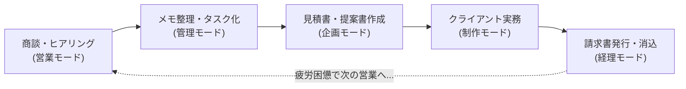
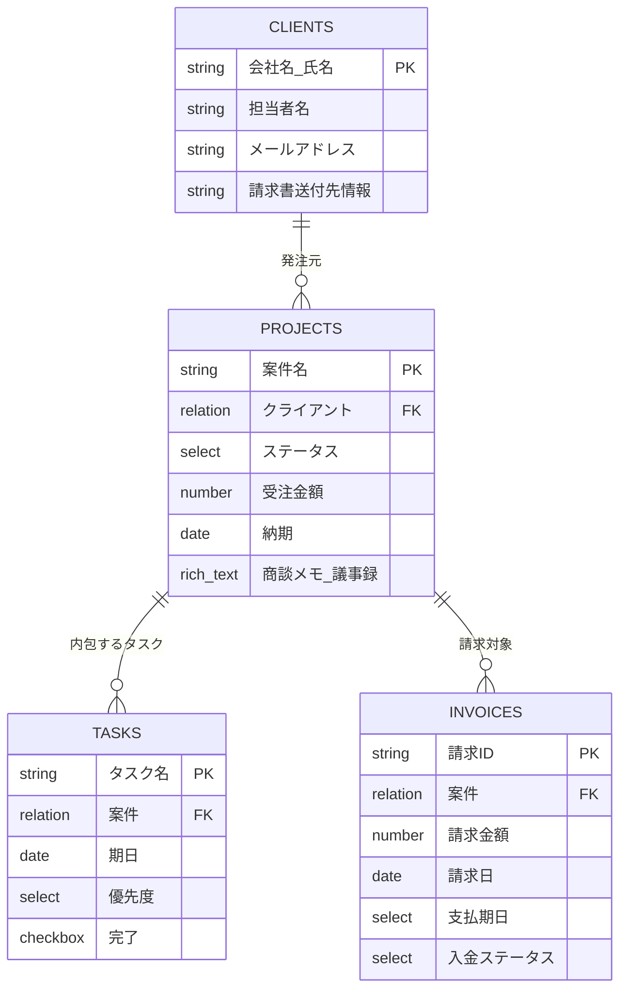
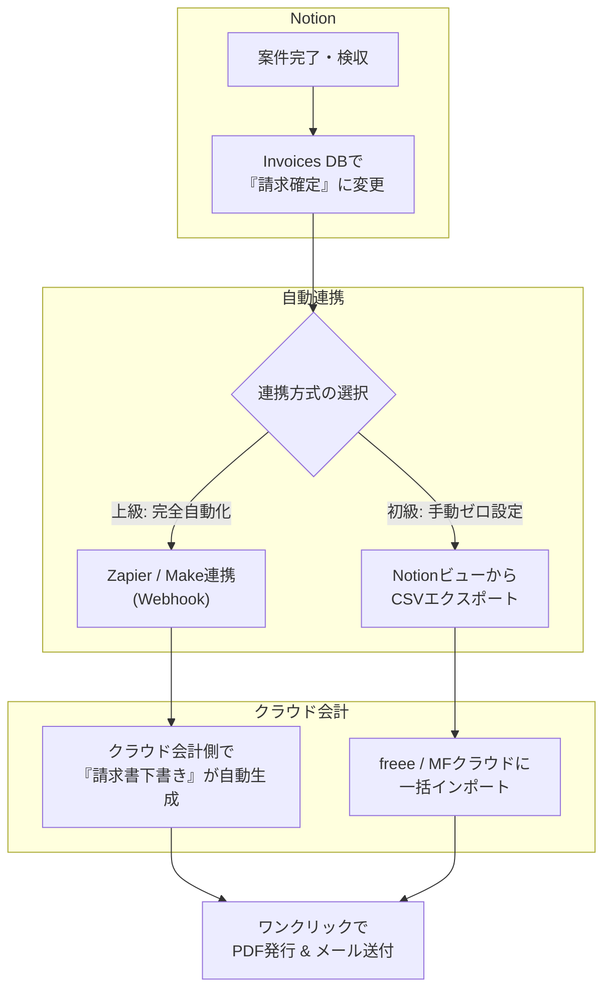
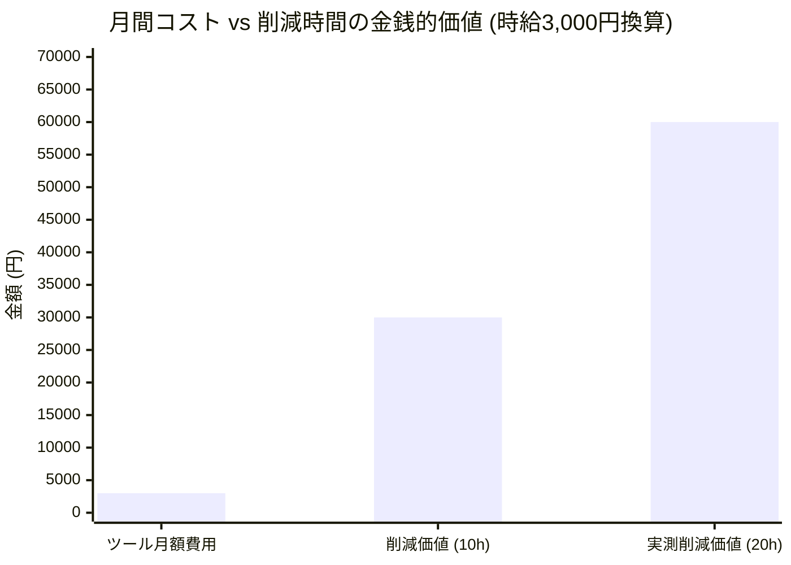

# 【ワンオペ脱却】一人起業家のための「Notion AI×クラウド会計」自動化コックピット構築術──商談メモから請求管理まで、月20時間の可処分時間を生み出すワークフロー

こんにちは！「仕事効率化・生成AIツール特化メディア」のフリーランス・個人事業主担当ライターです。

突然ですが、ソロプレナー（個人事業主・ひとり社長・副業ワーカー）の皆さん、日々の業務でこんな「ため息」をついていませんか？

> 「商談が終わった後の殴り書きメモ、整理しなきゃと思いつつ放置してタスクが漏れた…」  
> 「月末になると、請求書の作成と入金確認だけで半日潰れる…」  
> 「実務（クライアントワーク）をやりたいのに、バックオフィス雑務ばかりに追われて一日が終わる…」

一人ですべてをこなすワンオペビジネスにおいて、最大のボトルネックは「実務」ではなく、実務の周りにへばりつく**「事務・管理の摩擦コスト」**です。

人を雇うほどの固定費リスクは負えないけれど、このままでは自分の時間が削られ、売上も頭打ちになってしまう──。

そこで本記事では、私が試行錯誤の末に構築した**「Notion AI × クラウド会計」による業務自動化コックピット**の全貌を公開します。商談メモを1クリックで「タスク・見積もり・次回アクション」に分解し、そのまま請求管理・クラウド会計までシームレスにつなげる実践ワークフローです。

さらに、**読者の皆様がそのままワンクリックで複製して使えるNotionテンプレート**と、気になる「AI有料課金の損益分岐点シミュレーション」も惜しみなくお届けします！

---

## 1. 導入：ワンオペの限界──なぜ一人起業家は「雑務」に殺されるのか？

ソロプレナーの仕事は、営業、ヒアリング、提案、制作・開発、納品、請求、経理、発信と、大企業の全部署を一人で兼任しているようなものです。

特に痛烈なのが**「コンテキストスイッチ（思考の切り替え）の多さ」**です。



商談直後に「議事録をまとめなきゃ」「ToDoリストに転記しなきゃ」「見積書のドラフト作らなきゃ」とツールを右往左往しているうちに、集中力はすり減り、気づけば夕方。「あれ、今日クリエイティブな実務を何時間できたっけ…？」という自己嫌悪に陥ることも少なくありません。

この悪循環を断ち切る唯一の解は、**「情報の入力窓口を一箇所に絞り、AIに構造化させ、後続の業務へ自動で流す仕組み（コックピット）」**を持つことです。

---

## 2. 実測タイムログ：月25時間かかっていた雑務が「月5時間」に激減した全記録

私がこの「Notion AI×クラウド会計コックピット」を本格導入する前と後で、毎月の管理業務にかかっていた時間を実測・比較してみました。

| 業務プロセス | 導入前（手動運用） | 導入後（AIコックピット） | 削減時間（月間） | 変化のポイント |
| :--- | :--- | :--- | :--- | :--- |
| **商談メモの整理・タスク分解** | 約8時間（40分×12回） | 約1.5時間（8分×12回） | **-6.5時間** | 箇条書きメモからNotion AIが1発でToDoと要件を抽出 |
| **見積書・提案スコープの作成** | 約6時間（60分×6回） | 約1.5時間（15分×6回） | **-4.5時間** | 商談議事録から見積項目・作業工数のドラフトを自動起草 |
| **案件ステータス・進捗管理** | 約4時間（日々の更新） | 約1時間（日々の更新） | **-3.0時間** | 関連DBが双方向リンクし、1箇所の更新で全ビュー同期 |
| **請求書発行・送付・消込** | 約7時間（月末の半日作業）| 約1時間（月1回の確認） | **-6.0時間** | Notionステータス連動でクラウド会計に下書き自動生成 |
| **合計** | **約25時間 / 月** | **約5時間 / 月** | **🎉 -20時間 / 月** |

### 浮いた「月20時間」がもたらしたもの
毎月20時間の可処分時間が生まれると、何が起きるでしょうか？
- **新規提案・営業活動に月3〜4件多く時間を割ける（売上直結）**
- **最新のAI技術やスキルアップのためのインプット時間を確保できる**
- **週末に「請求書作らなきゃ…」と憂鬱になる精神的ストレスがゼロになる**

「作業を頑張って早く終わらせる」のではなく、「作業そのものを仕組みで消し去る」。これが一人起業家が生き残るための鉄則です。

---

## 3. 「Notion業務コックピット」のデータベース設計

Notionで複雑な仕組みを作ろうとすると、挫折しがちです。ワンオペで運用し続けるコツは**「極力シンプルに、リレーションは最小限に」**すること。

私が採用しているコックピットは、以下の4つのデータベース（DB）で構成されています。



### コックピットの画面構成（ダッシュボード設計）
朝起きてNotionを開いたら、このダッシュボード1枚ですべてが完結します。

1. **Today's Actions（本日やること）**：`Tasks DB` から「未完了」かつ「期日が今日以前」のものを抽出。
2. **Active Pipeline（進行中案件）**：`Projects DB` をカンバン形式で「リード ➔ 商談中 ➔ 実務進行中 ➔ 納品・検収」と可視化。
3. **Billing Alerts（請求・未収金アラート）**：`Invoices DB` から「納品済みだが未請求」「支払期日を過ぎた未入金」を赤色で強調表示。

---

## 4. Notion AIの組み込み方：商談メモを1クリックで分解するプロンプト

ここが本システムの心臓部です。
商談中、私たちは綺麗な議事録を書く余裕はありません。「クライアントの要望」「納期」「予算感」「懸念点」を雑に箇条書きでメモするのが限界です。

そこで、`Projects DB` のページテンプレート内に**「Notion AIプロンプトブロック」**をあらかじめ埋め込んでおきます。

### 実際に使っているプロンプト（完全公開）

以下のプロンプトをNotion AIのカスタム指示、またはページ内のAIアクションとして設定します。

> [!TIP]
> **コピペで使える「商談メモ分解」AIプロンプト**
> ```markdown
> あなたは一流のプロジェクトマネージャー兼ビジネスアシスタントです。
> 上記の「商談メモ（粗削りな議事録）」を詳細に分析し、以下のフォーマットに沿って日本語で構造化して出力してください。
> 
> ### 1. 案件サマリー（3行以内）
> - クライアントの真の課題と目的
> - 今回合意した提供価値
> - 想定スケジュールと納期
> 
> ### 2. 見積もり算出のための要件・スコープ一覧
> | 項目 / 機能 | 詳細要件 | 想定工数 (h) | 備考・前提条件 |
> | :--- | :--- | :--- | :--- |
> | (抽出項目) | (具体的スコープ) | (目安工数) | (リスクや制約) |
> 
> ### 3. 次回アクション & タスク（期日・担当者付き）
> - [ ] 【自社】(タスク名) （期日: YYYY/MM/DD）
> - [ ] 【クライアント】(確認・提供依頼事項) （期日: YYYY/MM/DD）
> 
> ### 4. 懸念点・確認すべきペンディング事項
> - (商談中に未確定だった点や、今後トラブルになりそうなリスクを箇条書き)
> ```

商談が終わったら、雑多なメモを選択して「AIに依頼」を押すだけ。
わずか10秒で、**「クライアントにそのまま送れる次回アクション確認メールの文面」**と、**「見積書に転記できる工数テーブル」**、そして**「自分が今日やるべきToDo」**が一瞬で目の前に現れます。

あとは抽出されたToDoをドラッグ＆ドロップで `Tasks DB` に放り込むだけで、案件セットアップが完了します。

---

## 5. クラウド会計（freee / マネーフォワード等）との連携と自動化

案件が無事納品されたら、次は「請求」です。ここでも多くのソロプレナーが「請求書ソフトを開いて、案件名をコピペして、金額を打ち込んで…」と手作業を繰り返しています。

ここでは、スキル感に応じた2つの連携アプローチを紹介します。



### アプローチA：【超手軽】CSVインポート連携（所要時間：月3分）
Zapierなどの外部ツールを使わなくても、Notionのビューをクラウド会計のCSVインポート形式に合わせておくだけで劇的に速くなります。
1. Notionの `Invoices DB` に「freeeインポート用ビュー」を作成。
2. 項目順を「取引先コード」「品名」「金額」「請求日」「期日」に並べる。
3. 月末に「CSVエクスポート」し、クラウド会計にアップロードするだけ。転記ミスは完全にゼロになります。

### アプローチB：【完全自動】Make / Zapier連携（所要時間：月0分）
1. Notionのステータスが「請求確定」に変更されたことをトリガーにする。
2. Make経由でfreee / マネーフォワードのAPIを叩き、請求書の下書きを作成。
3. 作成された請求書のURLがNotionのプロパティに自動で書き戻される。

これにより、月末の「請求書発行日」という概念そのものが消滅します。納品ボタンを押した瞬間に、請求書の下書きが用意されている状態が作れます。

---

## 6. 【読者特典】ワンクリックで複製できる「Notion業務コックピット」テンプレート

本記事で解説したデータベース、AIプロンプト、ダッシュボード構成をそのままパッケージ化した**Notionテンプレート**をご用意しました！

> [!IMPORTANT]
> ### 🎁 読者限定配布：『Solo-Cockpit v1.0』
> **[👉 ここをクリックしてNotionテンプレートを複製する（Duplicate）](#)**  
> *(※ご自身のNotionワークスペースにワンクリックで無料複製できます)*

### テンプレートに含まれているもの
1. **メインダッシュボード（今日のタスク・進行案件・未収金通知）**
2. **4大データベース（Clients / Projects / Tasks / Invoices）完全リレーション構築済み**
3. **商談メモ自動分解 AIプロンプトテンプレート**
4. **クラウド会計用 CSVエクスポートプリセット**
5. **導入後5分で初期設定が終わるスタートアップガイド**

まずは複製して、ダミーデータをご自身の進行中案件に書き換えてみてください。その日のうちに「あれ、頭の中がスッキリ整理されている…」という感覚を味わっていただけるはずです。

---

## 7. 損益分岐点シミュレーション：Notion Plus / AI課金は元が取れるか？

「Notion AIを使ってみたいけれど、月額コストを増やすのが怖い…」という声は本当によく聞きます。
そこで、コスパ重視のソロプレナー目線で**損益分岐点（元が取れるライン）**をシビアに計算してみました。

### コスト内訳
- **Notion Plusプラン**: 約10ドル / 月（約1,500円）
- **Notion AIアドオン**: 10ドル / 月（約1,500円）
- **月額合計**: **約3,000円 / 月**

### 損益分岐点（ROI）の計算
あなたの時給を仮に**3,000円**（フリーランスの平均的な実質稼働単価）と仮定します。

$$\text{回収に必要な時間} = \frac{3,000\text{円（月額ツール代）}}{3,000\text{円（時給）}} = 1.0\text{時間}$$

なんと、**月にたった1時間**業務が短縮できれば、ツール代の元は完全に取れます。



- **月間ツール投資**: 3,000円
- **本コックピットによる削減時間**: 月20時間
- **生み出される労働価値**: 20時間 × 3,000円 = **60,000円**
- **月間純利益（レバレッジ効果）**: 60,000円 - 3,000円 = **+57,000円 / 月**
- **ROI（投資対効果）**: **2,000%**

案件数で言えば、**「月に1件でも受注があるフリーランス」**なら、導入しない方が圧倒的に損（機会損失が大きい）と言える損益分岐点です。

---

## 8. まとめ ＆ 次のステップ

一人起業家にとって、時間は文字通り「命（資本）」そのものです。
雑務に忙殺されて新規営業やスキルアップができない状態は、ビジネスの緩やかな死を意味します。

まずは無料配布のテンプレートを複製し、次回の商談メモをAIに投げるところから始めてみてください。浮いた20時間で、新しい案件を獲りに行くもよし、家族や趣味の時間を楽しむもよし。自分らしい働き方を取り戻しましょう！

### さらに業務を自動化したい方へ（関連記事のご案内）
- **商談メモの精度をさらに極めたい方へ**  
  👉 [【記事①】AIプロンプトエンジニアリング実践ガイド：思い通りの要件定義を引き出すプロンプト技法](#)
- **MakeやWebhookを使った完全ノーコードAPI連携に挑戦したい方へ**  
  👉 [【記事④】Make×Notion×freee API完全自動化：請求書作成から消込まで人間が触らない世界の作り方](#)

---
*(文・編集部 フリーランス・個人事業主担当ライター)*
